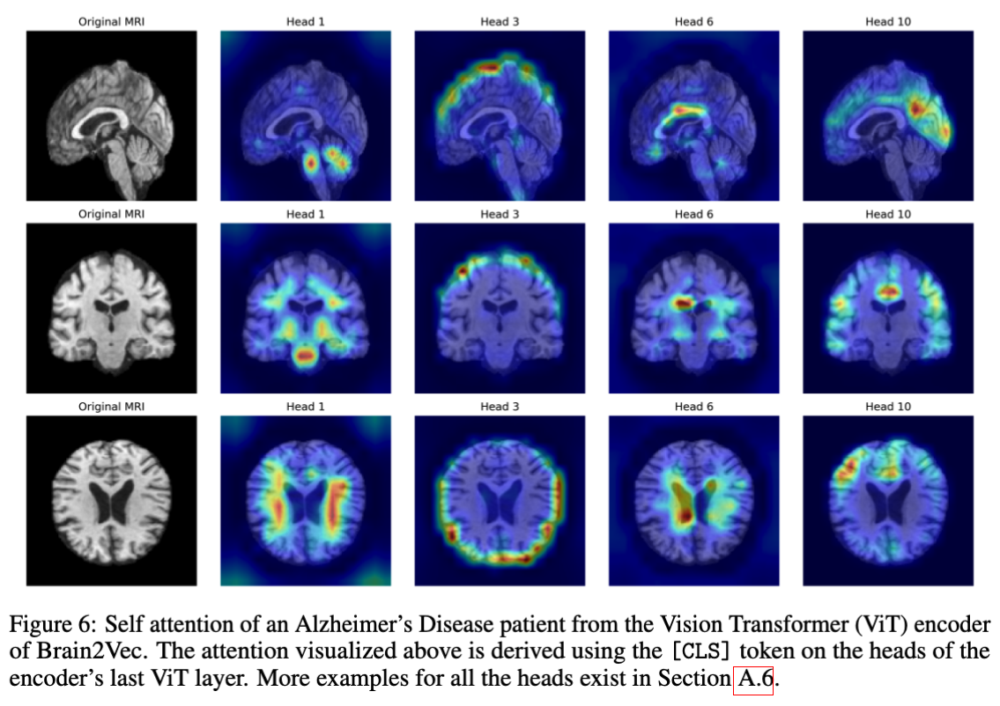
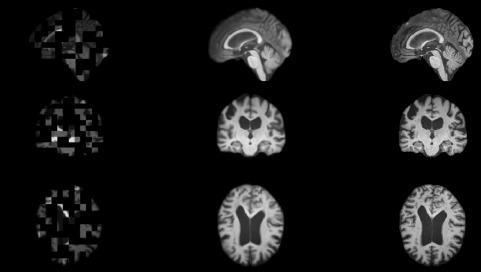
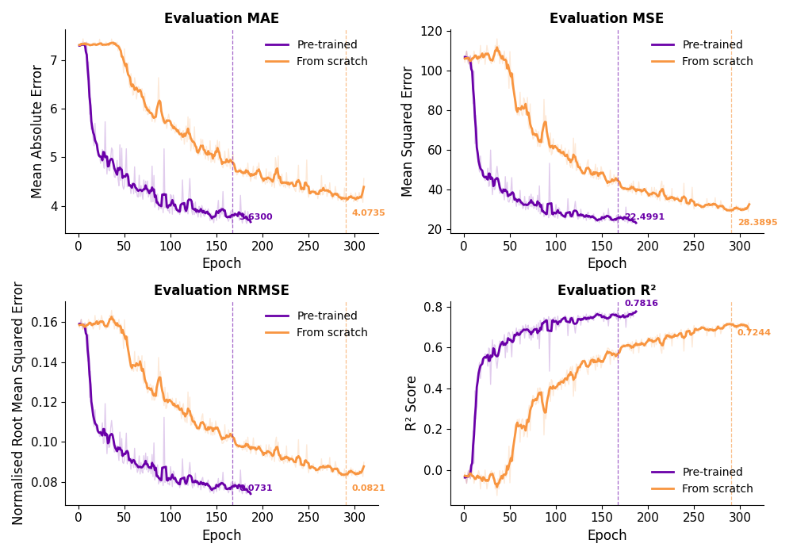
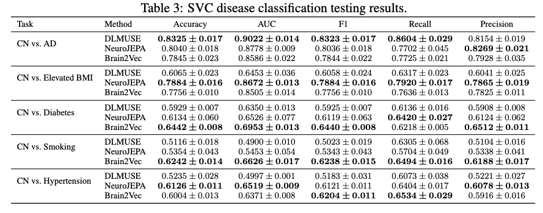
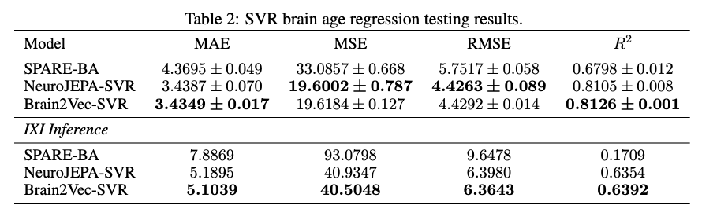
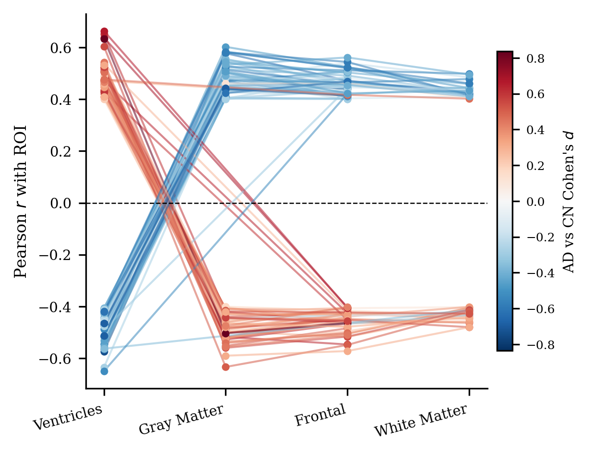

# Brain2Vec: A Self-Supervised 3D Foundation Model for Structural Brain MRI

<div align="center">

[](https://arxiv.org/abs/2610.28411)
[](https://huggingface.co/cbica/Brain2Vec)

</div>

Code for the [Brain2Vec](https://arxiv.org/abs/2610.28411) paper, a 3D foundation model pre-trained on 74,425
T1-weighted brain MRI scans. In this repo, you can pre-train your own brain2vec
model, fine-tune a Vision Transformer (ViT) using our pre-trained brain2vec
encoder, train your own downstream ML models using brain2vec output embeddings
or perform downstream classification inference using our pre-trained disease
classification models trained on brain2vec embeddings.

> [!IMPORTANT]
> To use our model locally, you first need to apply for access to our [hugging face model card](https://huggingface.co/cbica/Brain2Vec). 
> We follow a 2-step preprocessing with skull-stripping and linear registration,
> make sure to follow the steps [here](#pre-processing). **Don't perform inference on raw images locally**.
> You can always use Brain2Vec on [NiChart](https://neuroimagingchart.com) where
> you can upload your raw T1w MRI scans via cloud and obtain Brain2Vec
> scores **without preprocessing steps, installation or specialized
> infastructure (GPU)**.



*Left: Masked input | Middle: Reconstruction (Z-normalized) | Right: Ground truth*

## Fine-tuning with Brain2Vec

By fine-tuning with our pre-trained model, we achieved both better accuracy and
convergence speed on downstream deep learning tasks



## Using Brain2Vec as a feature extractor

We proved that using Brain2Vec embeddings we get superior or on-par classification
performance across multiple disease groups as well as better accuracy than
NeuroJEPA and DLMUSE ROI's for brain age regression.




We also proved that foundation models focus on limited but important set of brain
regions. Manipulating a subset of important latent features produces monotonic,
region-specific effects on the reconstructed anatomy.



* Brain2Vec implementation follows the code of [Masked Autoencoders](https://github.com/facebookresearch/mae) from Meta.

* Vision Transformers implementation follows the code of [timm](https://github.com/huggingface/pytorch-image-models) from huggingface.


## Pre-processing
Before using any of our models locally, make sure that the input is
skull-stripped and linearly registered to a common atlas space. We use
[NiChart\_DLMUSE](https://github.com/CBICA/NiChart_DLMUSE) for skull-stripping (DLICV folder)
and [flirt](https://fsl.fmrib.ox.ac.uk/fsl/docs/registration/flirt/index.html)
for registration, though you can use any skull-stripping model and
achieve comparable results.

  ```bash
  NiChart_DLMUSE -i {dir with nifti files} -o ... --refaced-data
  flirt -i {s3_masked NiChart_DLMUSE output} -ref registration/img_template.nii.gz -o ...
  ```
You can use Brain2Vec for both feature extraction and disease/risk-factor classification or brain age prediction
on [NiChart](https://cloud.neuroimagingchart.com) by simply dragging and dropping your NIfTI files, **we perform pre-processing for you, also no GPU or installation required**.

## Installation
You can install Brain2Vec locally using pip
```bash
pip install -e .
```

## Brain2Vec pre-training

We trained with two A100 GPUs for 500 epochs with a patience of 20 epochs. For
more training details please read the Brain2Vec paper.
Using our code, you can parallelize your training on SLURM cluster environments.
Other environments are supported but not tested, so bugs may appear.

```bash
srun Brain2Vec brain2vec_pretrain --img_size 128 \
                         --masking_type random \
                         --mask_ratio 0.75 \
                         --model brain2vec_base \
                         --in_dir "input directory with train/test/eval
                         subdirectories" \
                         --batch_size 32 \
                         --out_dir "directory where the model will be
                         saved" \
                         --model_name "model name (.pth)" \
                         --device cuda \
                         --lr 0.001 \
                         --weight_decay 0.05 \
                         --optimizer AdamW \
                         --epochs 500 \
                         --patience 20 \
                         --distributed \
                         --verbose \
```

## Vision Transformer (ViT) fine-tuning

One way of using Brain2Vec is for encoder fine-tuning. The pre-trained encoder
weights can serve as initialization for Vision Transformer (ViT) models applied
to downstream tasks like disease classification or brain age regression.

The only thing you need is a csv with MRID and target columns.

```bash
srun Brain2Vec vit_finetune --img_size 128 \
                         --mode binary \
                         --model vit_base \
                         --label_dict "csv with MRID and target columns" \
                         --target "target column" \
                         --pretrain "brain2vec.safetensors (model name from our
                         hugging face)" \
                         --in_dir "input directory with train/test/eval
                         subdirectories" \
                         --batch_size 32 \
                         --out_dir "directory where the model will be
                         saved" \
                         --model_name "model name (.pth)" \
                         --device cuda \
                         --lr 0.001 \
                         --weight_decay 0.05 \
                         --optimizer AdamW \
                         --epochs 200 \
                         --patience 20 \
                         --distributed \
                         --verbose
```

## Inference

One other way of using Brain2Vec is for feature extraction. We can use the
Brain2Vec frozen encoder to produce 768-dimensional embeddings from T1 scans.
This compact numerical representation serves as input for lightweight downstream
classifiers, such as SVM or MLP models.

```bash
python inference.py brain2vec_inference --model brain2vec_base \
                                    --img_size 128 \
                                    --in_dir "path to directory with nifti scans" \
                                    --out_json "name of json file with output embeddings" \
                                    --device cuda

python inference.py vit_inference --model vit_base \
                                --num_classes 1 \
                                --img_size 128 \
                                --mode regression \
                                --in_dir "path to directory with nifti scans" \
                                --out_csv "output CSV file with predictions" \
                                --device cuda
```

## Use Brain2Vec embeddings for downstream tasks

We provide a simple pipeline that enable users to train their own ML models
using output embeddings from Brain2Vec.

```bash
python train_svm.py dx_classification --cn_embeddings "path to your CN embeddings (.json)" \
                                      --dx_embeddings "path to your DX embeddings (.json)"

python train_svm.py ba_regression --embeddings "path to your embeddings (.json)" \
                                  --label_dict "path to a CSV that contains MRID and Age columns"
```

## Citation
If you use our model, make sure to cite our work:
```
@misc{maggioros2026brain2vecselfsupervised3dfoundation,
      title={Brain2Vec: A Self-Supervised 3D Foundation Model for Structural Brain MRI},
      author={Spiros Maggioros and Guray Erus and Gareth Harman and George Aidinis and Alexander Getka and Aristeidis Sotiras and Christos Davatzikos},
      year={2026},
      eprint={2610.28411},
      archivePrefix={arXiv},
      primaryClass={cs.CV},
      url={https://arxiv.org/abs/2610.28411},
}
```
